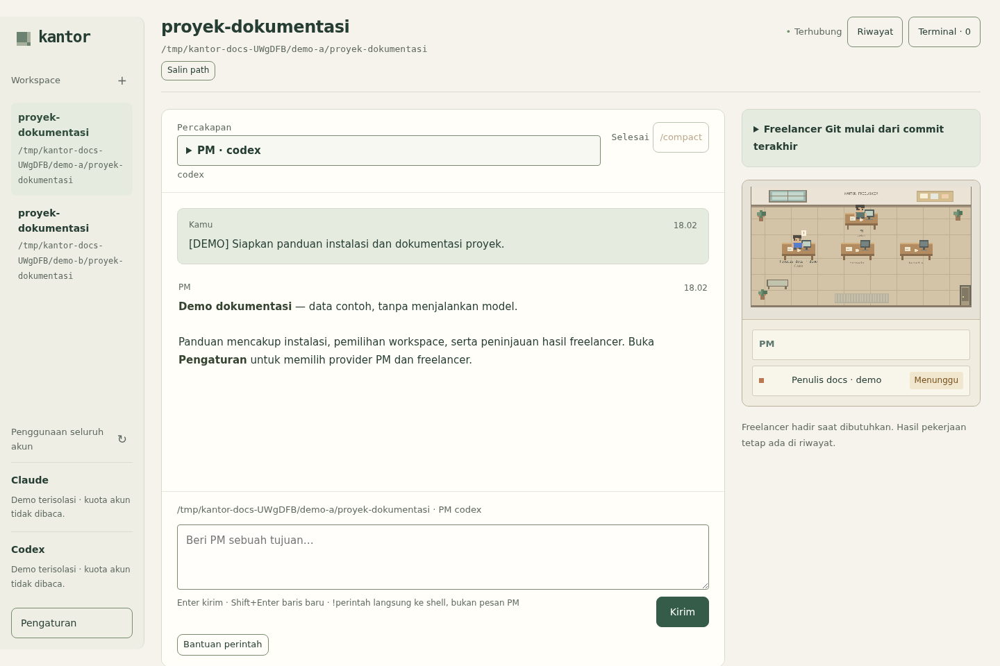
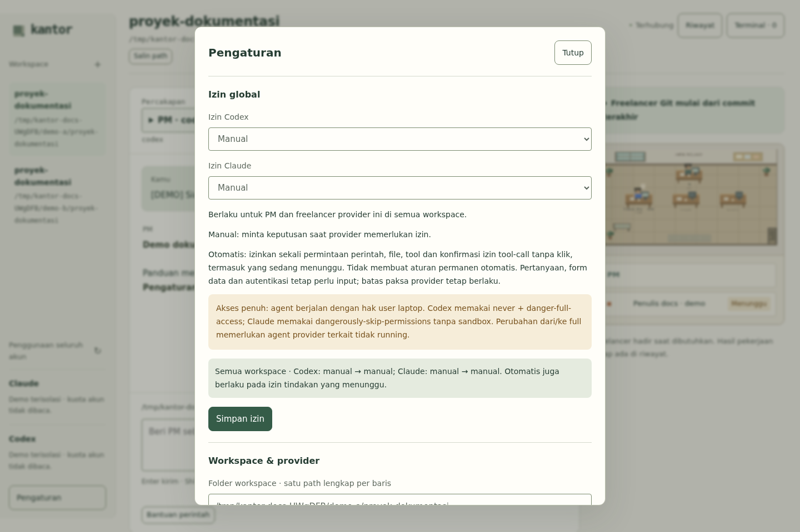

# Kantor — PM dan freelancer sementara

Kantor adalah aplikasi web lokal untuk mengelola pekerjaan Claude Code dan Codex dari satu percakapan dengan **PM**. PM membagi tugas kepada freelancer saat diperlukan. Freelancer muncul di kantor piksel selama bekerja, lalu pergi setelah selesai; hasil dan percakapannya tetap tersimpan dalam riwayat. Tidak ada departemen, statistik karyawan, XP, atau daftar pekerja permanen.

Aplikasi berjalan di komputer Linux Anda, memakai login CLI yang sudah ada, dan menyediakan pemilihan workspace, persetujuan perintah, peninjauan perubahan Git, penjadwalan, indikator kuota akun, serta terminal interaktif.

## Tampilan aplikasi

Screenshot berikut diambil dengan browser Chromium dari **aplikasi asli pada instance demo lokal terisolasi**. Workspace, percakapan, dan status freelancer adalah data contoh berlabel demo; provider dan pembacaan kuota dimatikan. Screenshot ini tidak membuktikan eksekusi model atau delegasi nyata.





Lihat [cara mengambil ulang dan batas validasi screenshot](docs/screenshots/README.md).

## Persyaratan

- **Linux**, **Node.js 22+**, **npm**, dan **Git**.
- **Python 3** (`python3`) dan shell Linux melalui `$SHELL` (fallback `/bin/bash`) untuk terminal interaktif.
- **Claude Code dan/atau Codex CLI**, terpasang pada `PATH` dan sudah login untuk provider yang dipilih. PM dan freelancer dapat memakai provider berbeda. Dashboard sendiri tidak memerlukan login/token.
- Browser modern. Koneksi internet dan akses akun provider diperlukan untuk pekerjaan model dan pembacaan kuota.
- Jika instalasi `better-sqlite3` perlu dikompilasi karena binary siap pakai tidak tersedia, siapkan toolchain build native untuk distribusi Linux Anda, termasuk Python, `make`, dan compiler C/C++.

Periksa lingkungan dari terminal:

```sh
node --version
npm --version
git --version
python3 --version
command -v claude
command -v codex
```

Pemeriksaan login yang digunakan backend adalah `claude auth status` dan `codex login status`. Jalankan pemeriksaan untuk CLI yang digunakan. Jika belum login, gunakan alur login resmi CLI terpasang; panduan ini tidak mengasumsikan subperintah login yang belum diverifikasi. Jangan memasukkan token/kredensial ke chat atau README.

## Instalasi dan menjalankan

Ganti `<URL_REPOSITORY>` dengan URL repository Anda; alamat remote belum ditentukan. Contoh berikut mengasumsikan nama direktori checkout `orchestrator-agent`.

```sh
git clone <URL_REPOSITORY> orchestrator-agent
cd orchestrator-agent
npm install
npm run build
npm start
```

Buka **http://127.0.0.1:4317**. `npm start` menjalankan hasil build di foreground; gunakan `Ctrl+C` pada terminal asal untuk menghentikannya. Setelah memperbarui source, build kembali sebelum menjalankan `npm start`. `npm run dev` juga tersedia untuk build lalu menjalankan backend TypeScript; ini bukan mode hot reload frontend.

Arsip dependency terminal beserta lisensinya tersedia di [vendor/](vendor/README.md), sehingga dependency tersebut tidak bergantung pada checkout lain. Dependency npm lainnya tetap harus tersedia saat instalasi.

### Berjalan di background

Sebagai alternatif foreground, dari root checkout:

```sh
npm run office
npm run office -- status
```

`npm run office` membangun source terkini lalu menjalankan daemon di background. Perintah ini juga dapat **me-restart daemon lama atau service user yang sudah terpasang** jika sedang idle, agar aset UI dan API tetap cocok. Launcher menolak restart ketika tugas atau terminal masih aktif dan memverifikasi bahwa PID tercatat milik checkout ini sebelum mengirim sinyal.

Dari direktori lain:

```sh
npm --prefix /path/to/orchestrator-agent run office
```

Untuk menghentikan daemon ketika seluruh pekerjaan dan terminal sudah selesai:

```sh
npm run office -- stop
```

Menutup browser tidak menghentikan daemon atau worker; pertanyaan dan izin menunggu sampai Anda kembali. Sleep/shutdown laptop memutus eksekusi. Launcher background tidak memasang autostart dan tidak menjamin proses bertahan pada setiap kebijakan logout OS. Untuk autostart dan bertahan setelah logout, lihat [service systemd](#autostart-dengan-systemd-user).

## Penggunaan

1. Klik **+** di samping **Workspace** atau **Pilih folder workspace**, pilih folder lokal, lalu aktifkan workspace. Picker yang sama tersedia di **Pengaturan → Pilih folder…**; path lengkap juga dapat dimasukkan manual.
2. Klik **Agent workspace** untuk memilih provider PM, default freelancer, dan model khusus workspace aktif. Kolom model kosong memakai default provider. Workspace lama mengikuti default global sampai dikonfigurasi. Batas freelancer tetap global: tiga secara default, 1–10 di pengaturan lanjutan.
3. Kirim tujuan ke PM, misalnya “Baca proyek ini dan usulkan perbaikan dokumentasi.” Workspace A dengan PM Codex dan workspace B dengan PM Claude dapat berjalan bersamaan. Tambahkan B lewat **+ Workspace** saat A aktif, pilih B, lalu simpan **Agent workspace**. PM mengambil snapshot default freelancer dari workspace induknya; pilihan workspace di UI tidak mengubah tugas yang berjalan. Tidak ada permintaan model selama idle.

Perubahan provider/model/default pada workspace memerlukan PM dan freelancer workspace terkait selesai; workspace lain boleh tetap berjalan. Perubahan konfigurasi membuka sesi PM terpisah. Sesi sebelumnya tersedia di pilihan chat dan **Riwayat**, termasuk setelah model berubah. Override provider/model eksplisit pada tugas dan jadwal tetap dihormati. PM pada path yang saling mencakup tetap mengantre untuk menghindari konflik. Bukti pengujian lokal: [multi-workspace](docs/ux/multi-workspace/README.md).
4. Ketika PM mendelegasikan tugas, freelancer muncul di kantor. Klik karakter, tombol di bawah kantor, atau selector **Percakapan** untuk melihat chat/log langsung. Log worker hanya-baca; kirim arahan baru melalui PM.
5. Jawab pertanyaan dan permintaan izin di panel chat. Gunakan **Hentikan** untuk PM beserta anak aktifnya atau hentikan worker tertentu. Pekerjaan yang terputus harus dilanjutkan secara eksplisit.
6. Buka **Riwayat** untuk hasil dan transkrip freelancer yang selesai. Tinjau diff sebelum menyetujui penggabungan; baca [perilaku Git dan pemulihan](#file-git-dan-pemulihan) terlebih dahulu.

Instruksi PM, jawaban yang dipublikasikan, dan output perintah/tool yang dapat dibuka-tutup tersedia di chat. Worker selesai tetap dapat dipilih. **Muat pesan sebelumnya** mengambil pesan lama; output tool baru direkam setelah backend diperbarui, sedangkan sesi lama hanya menampilkan data yang sebelumnya sempat direkam. Kegagalan/interupsi ditandai agar ditinjau. Pesan mendukung bold, inline code, dan fenced code block, dirender melalui text node DOM.

Status dan izin diperbarui lewat SSE, disinkronkan saat tersambung kembali atau kembali ke tab, serta diperiksa setiap lima detik selama halaman terlihat. State yang tidak berubah tidak menggambar ulang UI.

Kantor memakai furnitur dan sprite yang digambar dengan kode pada Canvas 2D, tanpa framework UI atau game engine. Animasi mengikuti preferensi reduced motion dan berhenti ketika tab disembunyikan. Tombol worker menyediakan alternatif aksesibel untuk memilih karakter.

### Terminal dan perintah chat

| Perintah/kontrol | Fungsi |
| --- | --- |
| `/help` | Menampilkan daftar perintah chat yang didukung. |
| `/compact` atau tombol `/compact` | Meringkas konteks provider pada PM/worker yang dipilih, setelah sesi ada dan giliran aktif selesai. Riwayat chat aplikasi tetap tersedia. |
| `/terminal` atau **Terminal** | Membuka shell Linux interaktif di workspace. |
| `!git status` | Membuka terminal yang sama dan mengetikkan perintah ke shell, tanpa melalui PM. |
| **Hentikan terminal** | Menghentikan shell yang sedang terbuka. |

Terminal mendukung PTY, prompt, input password, `Ctrl+C`, resize, dan program interaktif. Input dikirim langsung ke shell dengan izin normal user daemon; output terminal terpisah dari konteks PM. Menyembunyikan panel atau menutup browser membiarkan shell hidup; membuka kembali panel menyambung ke buffer output terbatas dalam memori. Shell dan output tidak bertahan setelah restart daemon. Launcher menolak restart selama shell aktif.

Slash command lain ditolak di chat, bukan diteruskan sebagai instruksi model biasa. Untuk antarmuka provider lengkap, jalankan `claude` atau `codex` di Terminal; proses CLI itu terpisah dari percakapan PM dashboard. xterm.js dan Fit addon hanya dimuat ketika terminal dibuka.

Compaction memakai `thread/compact/start` pada Codex dan resume sesi dengan `/compact` native pada Claude. Referensi protokol yang dipakai pengembang: [Codex manual compaction](https://learn.chatgpt.com/docs/app-server#trigger-thread-compaction), [Claude programmatic CLI](https://code.claude.com/docs/en/headless).

### Jadwal pekerjaan

Buka **Pengaturan → Jadwal pekerjaan**. Jadwal memakai cron numerik lima field dan zona waktu, tanpa dashboard manajemen terpisah. Menit yang terlewat dilewati; jadwal tidak menumpuk run baru ketika run sebelumnya masih aktif atau terputus. Daemon harus berjalan agar jadwal dievaluasi.

## Izin dan batas akses

Server hanya bind ke `127.0.0.1`, memvalidasi host/origin, dan meminta JSON untuk request mutasi. Kontrol MCP internal memakai capability per task agar worker tidak mengontrol pekerjaan lain. Capability ini merupakan kredensial internal, bukan login dashboard.

Pendaftaran workspace mengizinkan tugas bekerja pada direktori tertentu; ini bukan jaminan kerahasiaan seluruh filesystem. Codex memakai sandbox provider dan persetujuan perintah tidak tepercaya. Claude memakai restricted mode, shell bersandbox, serta host izin MCP. Dalam mode manual/otomatis adapter mempertahankan batas provider. Mode akses penuh mengaktifkan bypass seperti dijelaskan di bawah. Persetujuan shell arbitrer tetap memerlukan perhatian karena ini bukan isolasi container. Variabel environment API key dibuang dari proses worker agar login CLI tidak diam-diam beralih ke penagihan API.

Mode izin dapat dipilih terpisah untuk Claude dan Codex di **Pengaturan → Izin global**:

- **Manual:** permintaan izin muncul di chat seperti biasa.
- **Izinkan otomatis:** permintaan perintah, file, tool, dan konfirmasi izin MCP tool-call disetujui sekali oleh orchestrator tanpa menunggu klik. Aturan izin permanen tidak dibuat otomatis. Pertanyaan, form berisi data, dan alur autentikasi tetap membutuhkan input. Permintaan perluasan sandbox yang tidak didukung ditolak tanpa berhenti menunggu.

- **Akses penuh · berisiko:** agent berjalan dengan hak user laptop. Codex memakai `never` + `danger-full-access`; Claude memakai `--dangerously-skip-permissions` tanpa sandbox. Perubahan dari/ke full memerlukan agent provider terkait tidak running.

Klik **Simpan izin** untuk mengganti manual ↔ otomatis saat agent atau terminal masih aktif. Pengaturan berlaku untuk PM dan freelancer provider tersebut di semua workspace, tersimpan setelah restart, dan juga diterapkan pada izin tindakan yang sedang menunggu. Mengubah registrasi lama/default global/batas worker masih mengharuskan agent dan terminal berhenti. Penambahan workspace lewat **+** tetap tersedia saat aktif; konfigurasi **Agent workspace** hanya memeriksa agent workspace terkait. Keputusan otomatis dicatat di audit dengan `automatic: true`; pembatasan paksa provider tetap berlaku. Manual/otomatis memakai host persetujuan aplikasi dan tetap mengikuti batas paksa provider; akses penuh menggunakan bypass provider. Bagian Agent workspace, Registrasi & default global, dan Lanjutan disimpan terpisah.

Kartu izin menampilkan perintah terminal, folder, dan pilihan provider secara tepat:

- **Codex:** pilihan yang benar-benar ditawarkan request, seperti sekali, sesi, aturan prefix perintah/jaringan, tolak, atau batal. Preview aturan menunjukkan cakupan persisnya. Izin sesi berlaku selama proses app-server saat itu; adapter membuat proses baru pada giliran berikutnya. Gunakan aturan tersimpan bila perlu persistensi.
- **Claude:** sekali/tolak dan saran aturan allow dari provider dengan tujuan aslinya (sesi/proyek/user). Pilihan always-allow yang disembunyikan provider tetap disembunyikan. Aturan Claude tersimpan diputar ulang dari audit persetujuan untuk run Agent Office berikutnya, tanpa memuat project hook atau pengaturan CLI lain.
- **Pertanyaan dan konfirmasi MCP:** tetap memakai alur input/konfirmasi terpisah. Pertanyaan menampilkan teks serta opsi yang dapat dibaca dan harus dijawab. Form konfirmasi tanpa field cukup diklik; UI mengirim objek kosong otomatis, termasuk ke backend lama. Izin `ask_user` hanya memperlihatkan pertanyaan yang akan datang; jawab pertanyaannya secara terpisah setelah izin diberikan.

Metadata protokol ada di **Detail teknis** dan catatan opsional ditutup secara default. Pemilihan aturan divalidasi server dan dicatat pada audit persetujuan; dalam mode Manual, request yang sudah menunggu tetap memerlukan jawaban. Referensi protokol: [Codex app-server approvals](https://learn.chatgpt.com/docs/app-server#approvals), [Claude permission suggestions](https://code.claude.com/docs/en/agent-sdk/user-input#handle-tool-approval-requests).

## File, Git, dan pemulihan

Worker memakai **Git worktree** bila tersedia. Pekerjaan non-Git pada direktori yang saling tumpang tindih dijalankan bergantian. Worker Git mulai dari **HEAD yang sudah di-commit**; perubahan belum di-commit pada checkout sumber tidak disalin. Repository baru harus memiliki **initial commit** sebelum worker dapat membuat worktree.

Review menampilkan perubahan sejak base commit worker dan preview teks terbatas untuk file untracked. Menyetujui penggabungan akan melakukan staging/commit pada perubahan worker, lalu menjalankan `git merge --no-ff --no-commit` pada checkout asal yang bersih. Tinjau dan commit integrasi akhir sendiri. Konflik dan worktree dipertahankan; `git merge --abort` membatalkan integrasi yang belum selesai.

Hasil, event, sesi, dan worktree tetap disimpan setelah freelancer pergi. Setelah crash, tugas aktif ditandai terputus dan izin lama kedaluwarsa. Tinjau aktivitas sebelum melanjutkan secara eksplisit; session ID provider tersimpan dipakai kembali. Pembatalan menghentikan process group provider. Tidak ada retry tugas gagal atau failover provider otomatis.

## Kuota akun

Sidebar menampilkan jendela penggunaan subscription Claude/Codex dan waktu reset. Ini kuota **seluruh akun**, termasuk penggunaan di luar aplikasi, bukan skor per agent atau estimasi biaya.

- **Codex:** metode app-server `account/read` dan `account/rateLimits/read` memakai login CLI yang ada. Pembacaan kuota tidak membuat thread atau memanggil model. Akun API-key-only mungkin tidak menyediakan limit subscription.
- **Claude:** endpoint OAuth hanya-baca yang juga digunakan Claw-Empire. Token dibaca di server dari `${CLAUDE_CONFIG_DIR:-~/.claude}/.credentials.json`. Ini bukan API kuota stabil yang terdokumentasi; akun tidak didukung, sesi kedaluwarsa, atau kegagalan jaringan menampilkan penjelasan, bukan angka nol buatan.
- Respons di-cache 60 detik dan request bersamaan berbagi satu pembacaan. Refresh manual memiliki interval minimum 15 detik; polling hanya saat UI terlihat. Nilai terakhir ditandai kedaluwarsa ketika pembacaan jaringan berikutnya gagal.
- Pembaca kuota tidak mengembalikan kredensial ke browser, menyalinnya ke database, atau mencatatnya ke log. Aplikasi tidak me-refresh kredensial Claude; CLI mengelola login.

Referensi implementasi: [Codex app-server](https://learn.chatgpt.com/docs/app-server), [integrasi kuota Claw-Empire](https://github.com/GreenSheep01201/claw-empire/blob/main/server/modules/workflow/agents/providers/usage-cli-tools.ts).

## Konfigurasi dan data

Pengaturan workspace/provider/model/batas worker disimpan lewat UI. Variabel berikut dibaca dari environment proses; aplikasi tidak memuat file `.env` secara otomatis.

| Variabel | Default / fungsi |
| --- | --- |
| `PORT` | `4317`; port HTTP pada loopback. |
| `ORCHESTRATOR_DATA_DIR` | `.data` pada root checkout; direktori database, log launcher, state, dan worktree. Path relatif di-resolve dari direktori kerja proses. |
| `CLAUDE_BIN` | `claude`; executable Claude Code. |
| `CODEX_BIN` | `codex`; executable Codex CLI. |
| `CLAUDE_CONFIG_DIR` | `~/.claude`; lokasi kredensial kuota Claude bila disesuaikan. |
| `SHELL` | Shell terminal interaktif; fallback `/bin/bash`. |

Contoh foreground dengan port dan direktori data berbeda, tanpa mengubah instance default:

```sh
npm run build
PORT=4318 ORCHESTRATOR_DATA_DIR="$PWD/.data/alternatif" npm start
```

Buka `http://127.0.0.1:4318`. Jangan menjalankan dua daemon pada direktori data yang sama. File privat disimpan di `.data/` secara default; database `office.db`, riwayat event, log, dan worktree dapat mengandung isi tugas. Pembersihan/retensi masih manual. Hindari mempublikasikan direktori data atau screenshot percakapan pribadi.

## Autostart dengan systemd user

Opsional, pada sistem dengan user service manager systemd:

```sh
npm run build
npm run service -- print
npm run service -- install
npm run service -- status
journalctl --user -u agent-office.service -f
```

Installer menulis `~/.config/systemd/user/agent-office.service`, mengaktifkan, dan memulai service. Jika daemon launcher terverifikasi sudah berjalan, service menunggu daemon itu keluar sebelum memulai pengganti tersupervisi sehingga instalasi mempertahankan pekerjaan aktif. **Stop/restart service secara eksplisit juga menghentikan daemon itu**; tunggu sampai pekerjaan idle. Pasang ulang setelah checkout dipindah atau instalasi Node dihapus.

Unit menyimpan path checkout/Node dan `PATH` saat instalasi, serta menetapkan direktori data checkout `.data`. Untuk menyesuaikan environment service, tinjau hasil `print` dan gunakan konfigurasi systemd yang sesuai; environment shell pada `npm start` tidak otomatis menjadi konfigurasi service terpasang.

Agar service bertahan setelah logout dan dapat berjalan sejak boot sebelum login, aktifkan linger sesuai kebijakan sistem (hak administrator mungkin diperlukan):

```sh
loginctl enable-linger "$USER"
```

Untuk melepas service:

```sh
npm run service -- uninstall
```

Sleep/shutdown perangkat, gangguan jaringan, dan limit provider tetap dapat memutus pekerjaan. Routing Apache opsional untuk **http://kantor.test** dijelaskan di [deploy/README.md](deploy/README.md); hostname tersebut bukan prasyarat instalasi. Catatan instalasi dan rollback spesifik laptop disimpan lokal serta dikecualikan dari Git. Baca dan sesuaikan installer administratif sebelum menggunakannya di mesin lain.

## Validasi

Pemeriksaan lokal tanpa sengaja mengirim tugas ke provider:

```sh
npm run check
npm test
npm run build
```

Pengujian mencakup persistensi PM/pesan awal bersamaan, visibilitas dan riwayat worker sementara, antrean tugas, capability terbatas, persetujuan/pemulihan, Git worktree, jadwal, parsing/cache/penanganan kredensial kuota, fixture protokol kedua CLI, terminal PTY, dan compaction. Batas dan catatan hasil per lingkungan ada di [docs/VALIDATION.md](docs/VALIDATION.md); screenshot demo memiliki [catatan validasi terpisah](docs/screenshots/README.md).

**Opsional, memakai provider nyata dan dapat mengonsumsi kuota subscription:**

```sh
npm run smoke -- claude
npm run smoke -- codex
```

Smoke test melakukan pertukaran awal/resume kecil. Screenshot demo tidak menggantikan pemeriksaan login, kuota, eksekusi model, delegasi, dan persetujuan provider nyata. Arah produk dijelaskan di [docs/ROADMAP.md](docs/ROADMAP.md).

## Troubleshooting

| Gejala | Yang diperiksa |
| --- | --- |
| `npm install` gagal | Pastikan Node 22+, arsip `vendor/` ikut ter-clone, akses registry/cache tersedia, dan toolchain native tersedia bila `better-sqlite3` perlu dikompilasi. |
| CLI tidak ditemukan / login diperlukan | Periksa `PATH`, `CLAUDE_BIN`/`CODEX_BIN`, lalu `claude auth status` atau `codex login status` dari user yang menjalankan daemon. Service memakai `PATH` saat instalasi. |
| Port sudah dipakai / daemon lain menggunakan data | Periksa `npm run office -- status`, log `.data/server.log`, atau journal service. Gunakan port **dan** direktori data berbeda untuk instance kedua. Jangan hapus PID/DB milik daemon aktif. |
| UI/API berbeda versi | Setelah pekerjaan dan terminal selesai, build dan jalankan ulang dengan metode launcher/service yang dipakai. `npm run office` membangun ulang dan dapat me-restart instance idle. |
| Restart ditolak karena tugas/terminal aktif | Selesaikan atau hentikan tugas lewat UI dan pilih **Hentikan terminal**; menutup browser saja tidak menghentikannya. |
| Worker gagal membuat worktree / `HEAD` belum ada | Repository harus memiliki initial commit. Tinjau file yang memang hendak dimasukkan, buat initial commit di repository proyek tersebut, lalu lanjutkan tugas. Worker tidak menerima perubahan checkout yang belum di-commit. |
| Merge ditolak / konflik | Checkout asal harus bersih dan worker selesai. Tinjau diff, selesaikan konflik sendiri, atau gunakan `git merge --abort` untuk membatalkan integrasi. Worktree tetap tersedia. |
| Kuota tidak tampil / kedaluwarsa | Baca penjelasan di sidebar; periksa koneksi dan login CLI. Tunggu interval refresh. Akun tertentu tidak menyediakan kuota subscription. |
| Terminal gagal terbuka | Periksa `python3`, executable `$SHELL`/`/bin/bash`, workspace terdaftar, dan batas 10 terminal aktif. Output shell hilang setelah restart daemon. |
| Pekerjaan terputus setelah crash/sleep | Tinjau riwayat dan perubahan file, kemudian lanjutkan secara eksplisit; izin lama kedaluwarsa dan tidak ada retry otomatis. |
| `kantor.test` tidak terbuka | Uji loopback terlebih dahulu. Hostname opsional memerlukan konfigurasi lokal Apache/hosts sesuai [catatan deploy](deploy/README.md). |
